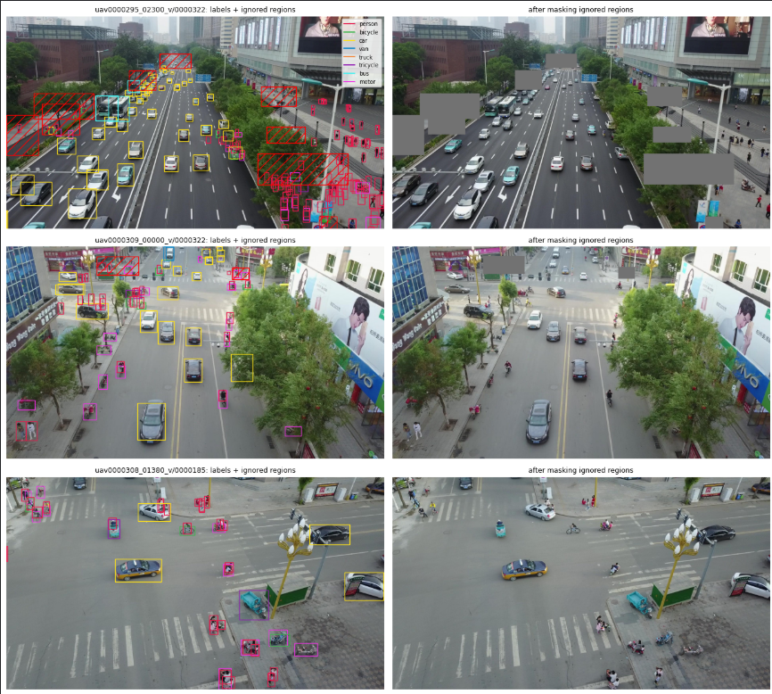
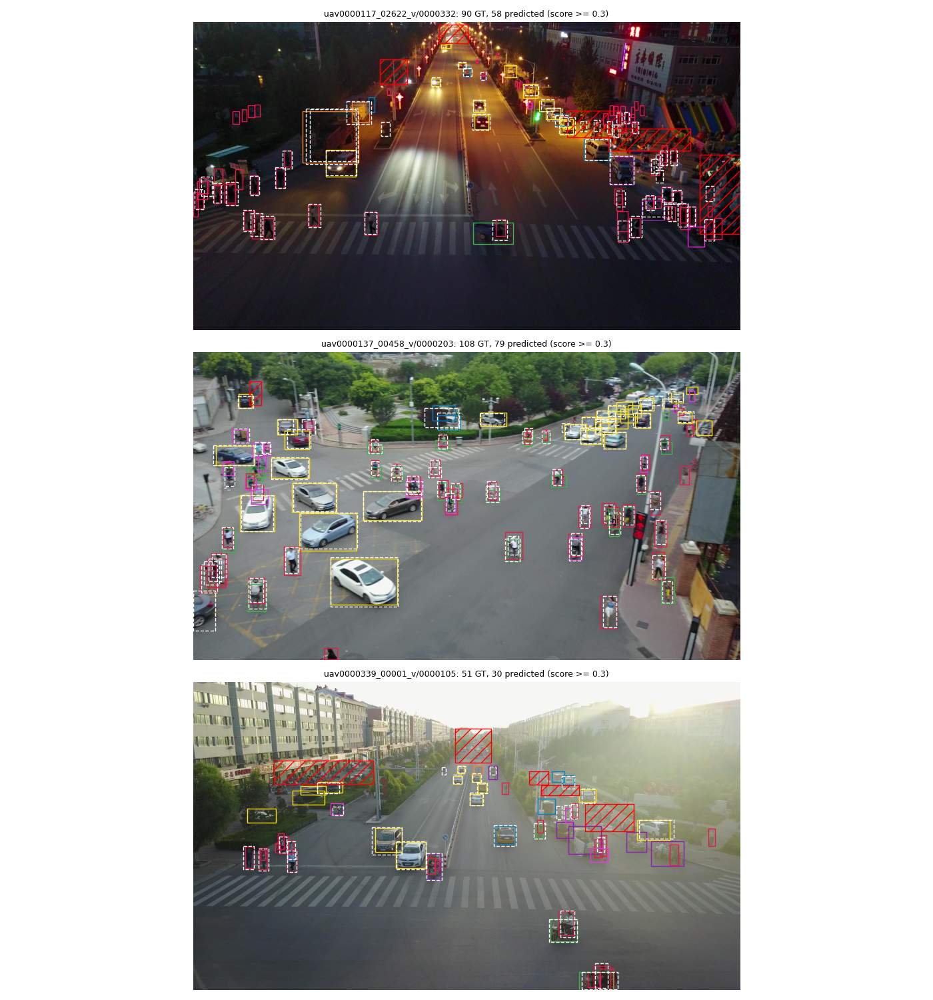

 
## 1. Задача і дані
 
Задача - детекція об'єктів таких як люди та різні типи транспорту на кадрах відео з дронів. для кожного кадру треба повернути рамки, класи і впевненість. Якість міряю COCO mAP@[.5:.95], як на лідерборді. Найкращий результат дав RT-DETR-L з 500 запитами, в нього 0.279 mAP на val і 0.307 на public.
 
| | кліпів | кадрів | об'єктів | ignore-регіонів | роздільності |
|---|---|---|---|---|---|
| train | 56 | 24 201 | 1 105 516 | 510 744 | 1344×756 … 3840×2160 |
| val | 7 | 2 846 | 114 132 | 31 960 | 1344×756 … 3840×2160 |
| test | 48 | 3 811 | — | — | **680×382**, 960×540, 1344×756 … |
 
| Спостереження з EDA (`01_eda.ipynb`) | Значення | Що з цього випливає |
|---|---|---|
| Середня щільність | 46 об'єктів на кадр, у найщільніших більше сотні | більше запитів у RT-DETR, максимум 500 детекцій на кадр |
| Частка об'єктів < 16 px після ресайзу | 640 px: 53.6% · 1024: 19.9% · 1280: 9.7% | вхід 1024 як протокол, 1280 як експеримент |
| Медіанний розмір 1024 px | 24.5 px; людина 37 px, автобус 112 px (оригінал) | менші якорі для RetinaNet |
| Той самий трек через 1 / 5 / 10 кадрів | медіанний IoU 0.90 / 0.60 / 0.36 | беру кожен 5-й кадр train |
| Кадри з ignore-регіонами (train) | 74.7%; об'єктів >50% всередині тільки 1.06% | маскую ці регіони сірим |
| Частково перекриті об'єкти | train 40.3%, val 52.4% | val складніший за train |
 

 
Важлива деталь що у test є кліпи з роздільністю 680×382 і 960×540, яких немає ні в train, ні у val. Тому val неповністю репрезентує test, і нижче кілька разів видно, що рішення, яке краще на val, на public виявляється гіршим.
 
## 2. Методологія
 
### 2.1 Підготовка даних і валідація
 
val складається з 7 цілих кліпів, і я його не змінював. Ділити треба по відео, а не по кадрах, бо сусідні кадри майже дублікати, тож випадковий спліт дав би витік і завищену оцінку. З тієї ж причини в train беру лише кожен 5-й кадр (4 868 кадрів). Через 5 кадрів медіанний IoU того самого треку падає до 0.60, тобто кадри вже помітно різні, а навчання стає в 5 разів дешевшим. Ignore-регіони в train-кадрах зафарбовую сірим (114), а рамки, що більш ніж наполовину лежать усередині них, викидаю (це ~1% об'єктів). Так модель не вчиться вважати фоном нерозмічені об'єкти в цих зонах.
 
Оцінка - COCO mAP@[.5:.95] через pycocotools на всіх 2 846 кадрах val, ignore-регіони як `iscrowd=1`, до 500 детекцій на кадр. Додатково дивлюсь на AP50, AP75 і AP_small/medium/large. Протокол однаковий для всіх моделей: ті самі кадри, маскування, вхід 1024 (крім експериментів з роздільністю), seed 42, одна T4.
 
### 2.2 Моделі
 
Порівнюю по одному представнику з чотирьох типів детекторів, і всі стартують з ваг, натренованих на COCO. Faster R-CNN і RetinaNet беру з torchvision, YOLOv8s і RT-DETR-L - з Ultralytics. Бюджет обмежений однією T4 на Kaggle, тому кожна модель вчиться приблизно 0.6–1.4 год. RT-DETR я обмежив за часом, а не за епохами. рівно стільки, скільки вчився базовий YOLOv8s, щоб порівняння двох моделей з Ultralytics було чесним. Для кожного типу після бази пробую дві зміни, мотивовані EDA або архітектурою.
 
| Тип | Модель | Бібліотека | Бюджет |
|---|---|---|---|
| two-stage anchor-based | Faster R-CNN R50-FPN v2 (COCO) | torchvision | 6 епох, SGD + cosine, AMP |
| one-stage anchor-based | RetinaNet R50-FPN v2 (COCO) | torchvision | 6 епох, той самий оптимізатор |
| one-stage anchor-free | YOLOv8s (COCO) | Ultralytics 8.4 | 12 епох |
| query-based | RT-DETR-L (COCO) | Ultralytics 8.4 | 0.6 год GPU (= час YOLOv8s base) |
 
## 3. Результати
 
Усі числа взяті з val. Де сабмітив є також public score.
 
### 3.1 Порівняння детекторів
 
| Експеримент | Що змінено | mAP | AP50 | AP_small | год | Public |
|---|---|---|---|---|---|---|
| `yolov8s_base` | вхід 1024 | 0.1879 | 0.3662 | 0.1014 | 0.58 | 0.2471 |
| `yolov8s_1280` | вхід 1280 | **0.2096** | 0.4115 | 0.1119 | 0.83 | 0.2533 |
| `yolov8s_p2` | + голова stride 4 | 0.1704 | 0.3556 | 0.0794 | 0.96 | 0.1832 |
| `frcnn_base` | — | **0.1920** | 0.3828 | 0.0859 | 1.03 | 0.2060 |
| `frcnn_dense_rpn` | більше пропозицій / RoI | 0.1914 | 0.3915 | 0.0786 | 1.38 | 0.1995 |
| `frcnn_giou` | GIoU-лосс замість smooth L1 | 0.1906 | 0.3867 | 0.0900 | 1.03 | 0.2135 |
| `retina_base` | якорі 32–512 | 0.1562 | 0.3035 | 0.0524 | 0.81 | — |
| `retina_anchors` | якорі 16–256 з даних | **0.1585** | 0.3414 | 0.0627 | 0.82 | 0.1611 |
| `retina_anchors_iou` | + IoU 0.4 / 0.3 | 0.1468 | 0.3168 | 0.0630 | 0.82 | — |
| `rtdetr_base` | 300 запитів | 0.2501 | 0.4902 | 0.1406 | 0.63 | — |
| `rtdetr_q500` | 500 запитів | **0.2791** | 0.5310 | 0.1477 | 0.62 | **0.3074** |
| `rtdetr_frozen_backbone` | backbone заморожено | 0.2507 | 0.4924 | 0.1190 | 0.62 | — |
 
**YOLOv8s.** Збільшення входу з 1024 до 1280 дало +0.022 mAP і +0.011 AP_small, і на public результат теж зріс. Це прямо підтверджує висновок з EDA що на 1024 п'ята частина об'єктів лишається меншою за 16 px. Додаткова голова stride 4, яка мала б допомогти дрібним об'єктам, навпаки погіршила все. Нова голова не має пре-трейну і за 12 епох не встигла збігтися бо крива валідації ще росла.
 
**Faster R-CNN.** Це найсильніша з torchvision-моделей, але обидві модифікації лежать у межах шуму. Більше пропозицій і RoI підняли AP50, але не загальний mAP. GIoU-лосс трохи покращив AP_small на +0.004 і public score бо для дрібних об'єктів зсув на кілька пікселів різко змінює IoU, тож точніша регресія рамок важить саме там.
 
**RetinaNet.** Найслабша модель. Без стадії пропозицій кожен якір є кандидатом, тому дисбаланс фон/об'єкт величезний. Focal loss його пом'якшує, але на щільних сценах з дрібними об'єктами цього замало. Якорі 16-256, підібрані за розмірами об'єктів у даних, допомогли: AP50 +0.038, AP_small +0.010. М'якші пороги IoU погіршили результат бо позитивними стає забагато якорів, які погано накривають об'єкт, і модель вчиться на шумних цілях.
 
**RT-DETR.** Найкращий тип за того самого часу навчання, з відривом за всіма метриками. Перехід з 300 на 500 запитів дав +0.029 mAP, бо в сценах із сотнями об'єктів 300 запитів просто не вистачає. Із замороженим backbone mAP лишився тим самим, але AP_small впав з 0.141 до 0.119. Ознаки з COCO погано підходять для дрібних об'єктів, знятих з висоти, тож backbone треба донавчати.
 
Швидкість інференсу між фреймворками я свідомо не порівнюю бо виміряний час на зображення включає читання JPEG до 4K, а torchvision і Ultralytics роблять це по-різному.
 
**Що дає кожна стадія Faster R-CNN** (recall @ IoU 0.5, 150 кадрів val):
 
| | small | medium | large | усі |
|---|---|---|---|---|
| пропозиції RPN (top 1000) | 58.4% | 72.9% | 98.6% | 73.1% |
| фінальні детекції (score ≥ 0.3) | 47.1% | 67.1% | 90.2% | 65.9% |
 
Уже на першій стадії RPN губить 42% дрібних об'єктів, і жодна наступна стадія не може їх повернути. Друга стадія зрізає ще 11% recall на дрібних. Отже, вузьке місце це пропозиції, а не «хвіст» RoI. Це пояснює, чому `frcnn_dense_rpn` не допоміг. Більше пропозицій того самого масштабу не знаходять об'єкти, яких RPN не бачить. Логічні наступні кроки це дрібніші якорі RPN або вищий вхід.
 
**Аналіз помилок.**
 
- **Нічна сцена.** Низький контраст і шум сенсора, а фари засвічують усе навколо себе. Пішоходи майже повністю пропускаються, машини часто знаходяться лише за фарами, а класи car/van плутаються. Ймовірна причина це те що нічних кліпів у train мало.
- **Щільне перехрестя.** Сотні об'єктів із сильними перекриттями. NMS придушує сусідні правильні рамки, а дрібні мотоцикли й люди зливаються в одну детекцію. плутаються також bicycle/motor. Імовірно, саме тут найбільше допомагає збільшення кількості запитів у RT-DETR.
- **Туман / засвітка.** Контраст падає, далекі дрібні об'єкти зникають на фоні, з'являються хибні спрацьовування на відблисках. Таких умов у train мало, а аугментації за яскравістю/контрастом я не налаштовував.

 
### 3.2 Пайплайн - дані та інференс (ваги yolov8s_1280 не змінюються)
 
| Зміна | mAP | AP50 | AP_small | Public |
|---|---|---|---|---|
| інференс 1280 (база) | 0.2096 | 0.4115 | 0.1119 | 0.2533 |
| інференс 1536 | 0.2154 | 0.4271 | 0.1200 | **0.2105** |
| TTA (фліп + масштаби) | 0.2146 | 0.4121 | 0.1173 | — |
| кадр + 2×2 шматки (SAHI-подібно) | 0.2076 | 0.4254 | 0.1149 | — |
| temporal rescoring α = 0.2 / 0.4 / 0.6 | 0.2159 / 0.2124 / 0.2042 | — | — | — |
| навчання без маскування ignore | 0.2000 | 0.3933 | 0.0974 | — |
| WBF з Faster R-CNN (1536, 2:1) | 0.2369 | 0.4631 | 0.1240 | 0.2407 |
| WBF з Faster R-CNN (1280, 2:1) | 0.2317 | 0.4512 | 0.1150 | 0.2608 |
 
**Що спрацювало.** Найбільший приріст дав ансамбль з детектором іншого типу. WBF YOLOv8s і Faster R-CNN з вагою 2:1 підняв val mAP на 0.022, а public - до 0.261. Одностадійний anchor-free і двостадійний anchor-based детектори помиляються по-різному, тому злиття рамок більше виправляє, ніж додає шуму. Маскування ignore-регіонів під час навчання теж себе виправдало бо без нього mAP нижчий на 0.0096, і втрата припадає переважно на дрібні об'єкти (AP_small 0.112 став 0.097). Це підтверджує рішення з EDA.
 
**Що не спрацювало.** Інференс на 1536 - найповчальніша невдача: на val +0.006, на public −0.043. Причина в кліпах 680×382 і 960×540 у test, яких немає у val. Розтягнуті у 2.3 рази, вони стають розмитими, і модель на них помиляється. Тут вибір лише за val підвів, тому фінальний інференс лишився на 1280. Те саме видно у WBF. Варіант на 1536 кращий на val, але гірший на public. Нарізка на шматки підняла AP50, але знизила загальний mAP бо рамки на межах шматків рвуться або дублюються, і це б'є по точній локалізації. TTA дав невеликий приріст на val +0.005, але на public я його не перевіряв. Temporal rescoring дав мізерний приріст лише за малої ваги і погіршував результат зі зростанням цієї ваги. Модель і так стабільна між сусідніми кадрами, а її помилки систематичні, такі як темрява, щільність, тож сусідні кадри помиляються так само і нічого не виправляють.
 
### 3.3 Пайплайн - модель
 
| Модель | Епох | mAP | AP_small | год | Public |
|---|---|---|---|---|---|
| YOLOv8s, 1280 | 12 | 0.2096 | 0.1119 | 0.83 | 0.2533 |
| YOLOv8m, 1280 | 12 | 0.2251 | 0.1365 | 2.16 | 0.2350 |
| YOLOv8m, 1280 (`final`) | 30 | 0.2107 | 0.1256 | 4.48 | 0.2553 |
| `final` + WBF з Faster R-CNN 2:1 | 30 | 0.2374 | 0.1280 | 4.48 | 0.2689 |
 
YOLOv8m на val помітно кращий за v8s, але на public гірший 0.235 проти 0.253. Тренування 30 епох замість 12 навпаки знизило mAP на val, а на public трохи підняло. Імовірно, ці суперечності мають ту саму природу, що й з 1536: val не покриває низьких роздільностей test, а різниці тут +-0.01–0.02 лише трохи більші за шум public, який видно на трьох Faster R-CNN. Головний висновок звідси це те що збільшення YOLO дає менше, ніж зміна типу детектора. RT-DETR-L за 0.6 год обходить YOLOv8m за 4.5 год. WBF з Faster R-CNN і тут дав стабільний приріст і на val, і на public.
 
## 4. Фінальне рішення
 
| Вибраний сабмішн | Val mAP | Public |
|---|---|---|
| `sub_rtdetr_q500.csv` — RT-DETR-L, 500 запитів | 0.2791 | 0.3074 |
| `sub_final_wbf.csv` — YOLOv8m + Faster R-CNN, WBF 2:1 | 0.2374 | 0.2689 |
 
Перший сабмішн це RT-DETR-L з 500 запитами бо він найкращий і на val, і на public, тобто тут оцінки узгоджуються, і на нього можна покладатися. Другий це ансамбль YOLOv8m і Faster R-CNN через WBF, найкраще рішення без трансформерів. Він побудований на зовсім інших моделях, тому є страховкою, якщо на private частині test RT-DETR поведеться гірше. Обидва варіанти роблять інференс на 1280 і не використовують зміни, де val і public розійшлися найсильніше.
 
## 5. Як відтворити
 
Усе запускалось на Kaggle. Спільний код -
`common.py` це дані, метрика, сабмішн, `tv_train.py` це torchvision, `pipeline.py` це інференс і ансамблі.
ноутбуки самі завантажують їх із цього репозиторію. Seed 42. Ultralytics 8.4.208, torch 2.11.
 
| Ноутбук | Налаштування | Результат |
|---|---|---|
| `01_eda.ipynb` | CPU | статистика, діаграми |
| `02_yolo.ipynb` | `RUN = ["yolov8s_base"]`, потім `["yolov8s_1280", "yolov8s_p2"]` | `sub_yolov8s_*.csv`, ваги |
| `03_faster_rcnn.ipynb` | `RUN` = усі 3 | `sub_frcnn_*.csv`, `*_preds_frcnn_base.pkl` |
| `04_retinanet.ipynb` | `RUN` = усі 3 | `sub_retina_*.csv` |
| `05_rtdetr.ipynb` | `RUN` = усі 3, `TIME_HOURS = 0.6` | **`sub_rtdetr_q500.csv`** |
| `06_pipeline.ipynb` | `STAGES = ["inference", "temporal", "ensemble", "nomask"]`; Input: виходи 02 і 03 | розділ 3.2 |
| `06_pipeline.ipynb` | `STAGES = ["rewbf"]` (CPU); Input: виходи 02 і 03 | `sub_wbf_yolo1280_frcnn.csv` |
| `06_pipeline.ipynb` | `STAGES = ["yolov8m_1280"]` | розділ 3.3 |
| `06_pipeline.ipynb` | `STAGES = ["final"]`; Input: вихід 03 | **`sub_final_wbf.csv`** |
 
## 6. Джерела
 
- Дані: Zhu et al., *Detection and Tracking Meet Drones Challenge* (VisDrone), arXiv:2001.06303.
- Метрика: Lin et al., *Microsoft COCO*, arXiv:1405.0312; pycocotools.
- Faster R-CNN: Ren et al., arXiv:1506.01497; FPN: Lin et al., arXiv:1612.03144; torchvision detection reference scripts.
- RetinaNet / focal loss: Lin et al., arXiv:1708.02002; підбір якорів k-means — YOLOv2, arXiv:1612.08242.
- GIoU: Rezatofighi et al., arXiv:1902.09630.
- YOLOv8 і RT-DETR: Ultralytics (docs.ultralytics.com); RT-DETR: Zhao et al., arXiv:2304.08069; TOOD, arXiv:2108.07755.
- SAHI (нарізка на шматки): Akyon et al., arXiv:2202.06934.
- Weighted Boxes Fusion: Solovyev et al., arXiv:1910.13302; пакет `ensemble-boxes`.
- Seq-NMS (ідея temporal rescoring): Han et al., arXiv:1602.08465.
- Код писався з допомогою ШІ-асистента (Claude), що дозволено умовою; експерименти, вибір рішень і звіт - мої.
 